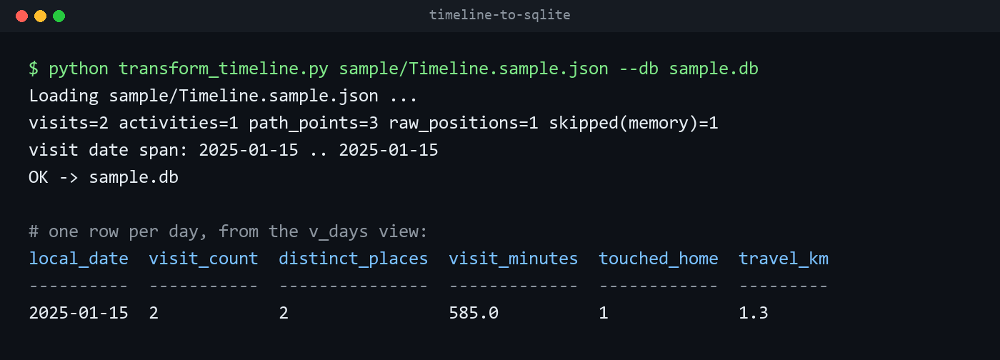

# timeline-to-sqlite

Turns a Google Maps Timeline export into one SQLite database you can query with plain SQL.



Google moved Timeline onto the phone, and the export you get from it is one large JSON file of visits, trips, route points and raw location fixes. I wanted that history in a form I could ask questions of and join against my other records by date, so this script reads the export and writes it into tables with the coordinates parsed and a local date on every row.

## What you get

| Table | One row per | Key columns |
|---|---|---|
| `visits` | place you stayed | start and end time, local date, minutes, lat/lng, place id, semantic type (HOME, WORK, ...), confidence |
| `activities` | movement between places | start and end time, local date, start and end lat/lng, mode (WALKING, IN_PASSENGER_VEHICLE, ...), distance in meters |
| `path_points` | point on a recorded route | time, local date, lat/lng, the route it belongs to |
| `raw_positions` | raw location fix | time, local date, lat/lng, accuracy, altitude, speed, source (GPS, WIFI, ...) |
| `frequent_places` | place Google marked as frequent | place id, lat/lng, label |
| `meta` | run | the source file and how many rows of each kind were written |

Plus a `v_days` view with one row per day: visit count, distinct places, minutes at places, whether you were home at all, and kilometers traveled.

## Requirements

- Python 3 (tested on 3.11). Standard library only, nothing to install.
- A Timeline export from your Android phone: Settings > Location > Location services > Timeline > Export Timeline data. Menu names vary by phone maker and Android version. You get a file called `Timeline.json` in your Downloads folder.

## Usage

```
python transform_timeline.py path/to/Timeline.json --db timeline.db
```

Every run drops and rebuilds all tables from the export you give it, so re-running after a newer export is safe. Keep your exports; the database is meant to be rebuilt from them, never edited by hand. Without `--db`, the database is written next to the script as `timeline.db`.

To see it work without your own data, run it on the invented sample:

```
python transform_timeline.py sample/Timeline.sample.json --db sample.db
```

The sample's places and coordinates are made up (they sit in open ocean off West Africa) and exist only to show the input shape.

## Querying

[`queries.md`](queries.md) has tested patterns: daily summaries, nights away from home, was I near a place on a given date, most-visited places, trip detection, "on this day," and a mobility-entropy measure of how spread out your time was across places.

## Notes and limits

- **Coordinates arrive as text.** The export writes `"<lat>°, <lng>°"` strings, and raw fixes spell the key `LatLng` while everything else uses `latLng`. The script handles both.
- **Times keep the offset they were recorded with.** `local_date` is the date on the clock where you were, which is what you want for day-by-day joins. Use the full timestamp when you need exact ordering across time zones.
- **Trip summaries are not stored.** Segments of type `timelineMemory` are counted in `meta` and skipped.
- **Coverage is not constant over the years.** Older history usually has far fewer recorded hours per month than recent history, because phones and Google's settings changed. A long-run trend (more places, more travel) can be a recording artifact rather than a change in your life. Check coverage for the window before you trust a trend.
- **Place matching uses rough boxes, not a geography library.** The queries compare latitude and longitude within a tolerance (0.01° of latitude is about 1.1 km). That is good enough for "was I at this venue that day," and you should tighten it for anything finer.

## Privacy

The database is a detailed record of where you have been. Keep it and your exports out of any repository or shared folder; this repo's `.gitignore` already ignores `*.db` and `Timeline.json`.

## License

MIT. See [LICENSE](LICENSE).
